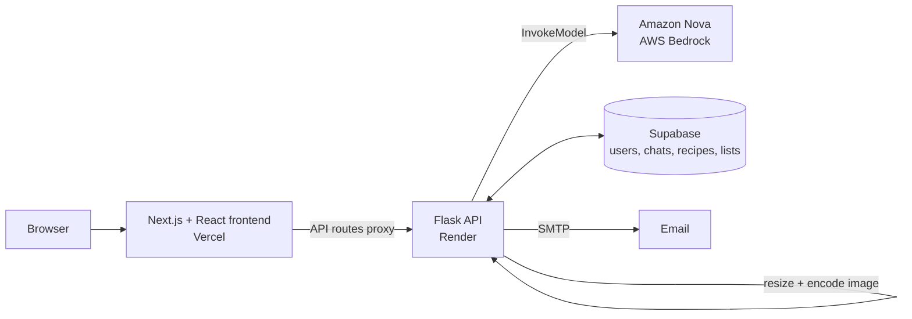

<div align="center">

# ChopChop 🍳

**Snap a photo of your fridge. Get recipes you can actually make, and a grocery list for the rest.**

An AI kitchen assistant co-built by a team of two (Aug–Oct 2025), deployed with the frontend on Vercel and the API on Render.


</div>

---

## What it does

- **Fridge photo → ingredients → recipes.** Upload a photo and a multimodal model (Amazon Nova on AWS Bedrock) identifies what's in your fridge, then generates personalized recipes from it.
- **Grocery lists.** Missing ingredients become a checklist you can track and edit.
- **Pantry, recipes and history.** Browse saved recipes, manage your pantry, and pick up past chats; recently selected meals are remembered.
- **Share by email.** Send a grocery list or recipe to yourself or someone else.
- **Accounts.** Sign in, and your data persists across sessions.

## Architecture



The browser never talks to Bedrock or holds AWS credentials: Next.js API routes proxy requests to the Flask backend, which preprocesses images (downscales large photos and caps the payload size) before sending them to the model.

## What I worked on

ChopChop was co-built end to end, and I worked across every layer:

- **AI pipeline:** the multimodal flow on AWS Bedrock (Amazon Nova) that reads fridge photos, identifies ingredients and generates recipes and grocery lists.
- **Backend:** the Python Flask API, including image preprocessing and REST endpoints for chat, auth sessions, saved data, recent recipes, chat history and email.
- **Persistence:** Supabase storage for user accounts, chat history, recipes, grocery lists and recently selected meals.
- **Frontend:** Next.js/React (TypeScript) interfaces for recipe browsing, pantry management, grocery-list tracking and email sharing.
- **Deployment:** Vercel for the frontend, Render for the API.

## API overview

| Endpoint | Purpose |
|---|---|
| `POST /chat` | Chat with the model, with an optional fridge photo |
| `POST /auth/signin`, `/auth/verify`, `/auth/signout` | Session management |
| `POST /save-data`, `/get-data`, `/update-data` | Grocery lists, recipes and pantry |
| `POST /recent-recipes/add`, `/recent-recipes/get` | Recently selected meals |
| `POST /chat-history` | Past conversations |
| `POST /send-email` | Share a list or recipe |
| `GET /health` | Health check |

## Run it locally

**Requirements:** Python 3.11+, Node 18+, an AWS account with Bedrock access to Amazon Nova, and a Supabase project.

```bash
# backend
cd backend
pip install -r requirements.txt
# set AWS_REGION, AWS_ACCESS_KEY_ID, AWS_SECRET_ACCESS_KEY,
# SUPABASE_URL, SUPABASE_ANON_KEY, SUPABASE_SERVICE_ROLE_KEY
python nova_backend.py            # http://localhost:8000

# frontend (new terminal)
cd nova-chat-frontend
npm install
# set NEXT_PUBLIC_SUPABASE_URL and NEXT_PUBLIC_SUPABASE_ANON_KEY in .env.local
npm run dev                       # http://localhost:3000
```

Or run `./start_chopchop.sh` to start both. Database setup is in `supabase_schema.sql`; deployment notes are in `DEPLOYMENT_GUIDE.md` and `RENDER_AWS_SETUP.md`.

## Project structure

```
backend/              Flask API, Bedrock + Supabase integration, test scripts
nova-chat-frontend/   Next.js app: chat, pantry, recipes, grocery list, auth
supabase_schema.sql   Database schema
render.yaml           Render deployment config
vercel.json           Vercel deployment config
```

## Team

Co-built by [Alex Xavier](https://github.com/alexxaviers) and [Abhishek Prabhu](https://github.com/AbhishekPrabhu0914). Original repository: [AbhishekPrabhu0914/ChopChop](https://github.com/AbhishekPrabhu0914/ChopChop).
